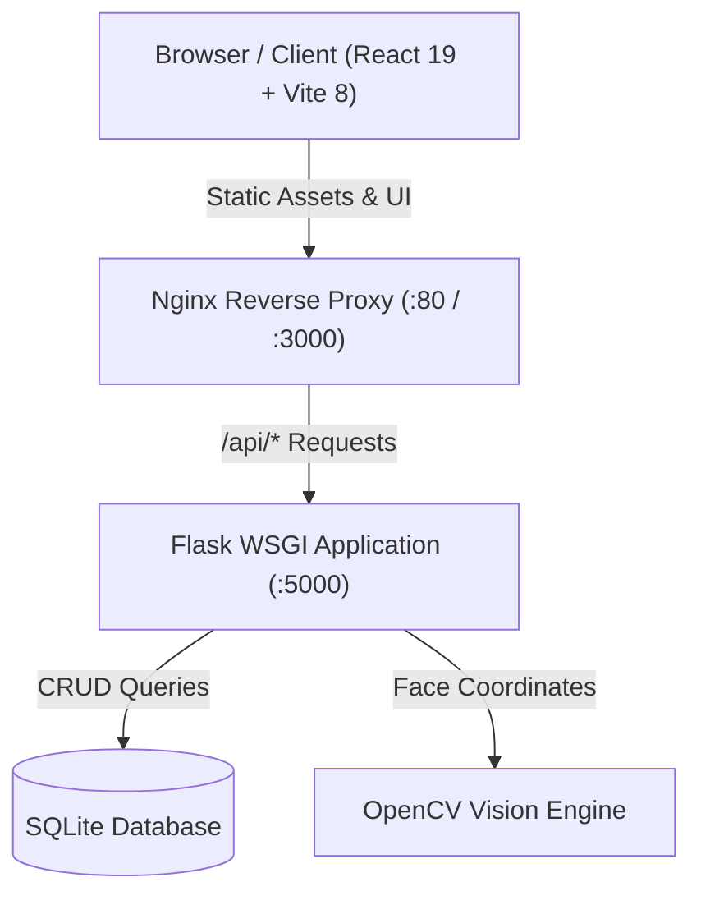

# 🎓 ClassroomOS — Modern Classroom & Attendance Management System

[](https://github.com/Bilal-ai-stack/classroom-management/actions/workflows/ci.yml)
[](https://github.com/Bilal-ai-stack/classroom-management/actions/workflows/docker.yml)
[](https://bilal-ai-stack.github.io/classroom-management/)

A full-stack classroom and attendance management system featuring student portfolios, one-click daily roster recording, attendance analytics, computer vision photo-assisted detection, dark/light theme switching, and automated CI/CD with Docker containerization.

---

## 🌟 Key Features

- **Student Portfolio Management**: Create, edit, search, filter, and archive student profiles with enrollment dates, guardian contact, and historical records.
- **Bulk CSV Roster Import**: Import class rosters instantly by pasting standard CSV data.
- **Daily Attendance Roster**: One-click status toggles (Present, Late, Absent), remarks input, "Mark All Present", and batch persistence.
- **Attendance Analytics & CSV Reports**: Filter attendance trends across custom date ranges with interactive breakdown cards and one-click CSV export.
- **Photo-Assisted Attendance Review**: Face detection workflow (OpenCV Haar Cascade) with privacy-first local processing and zero biometric template storage.
- **Dark & Light Mode**: Accessible design system with fluid theme switching and micro-animations.
- **Containerized Deployment**: Multi-stage production Dockerfiles and Docker Compose setup for both local execution and Docker Hub distribution.

---

## 🏗️ System Architecture



---

## 🐳 Docker Deployment & Docker Hub

### 1. Run the Entire Stack Locally (Docker Compose)
Ensure Docker Desktop is open and run:
```bash
docker compose up --build
```
- **Web Application**: Access at `http://localhost:3000` (or `http://localhost:80`)
- **Backend API**: Reverse-proxied at `http://localhost:3000/api/` (or directly at `http://localhost:5000/api/health`)

### 2. Build Images Locally
Using the included PowerShell script:
```powershell
.\docker-build.ps1
```
This builds:
- `classroom-backend:latest` (Python 3.11-slim + Gunicorn)
- `classroom-frontend:latest` (Node.js 20 multi-stage build + Nginx Alpine)

### 3. Push Images to Docker Hub
```powershell
.\docker-push.ps1 -DockerHubUsername <your_dockerhub_username>
```

### 4. Automated CI/CD Publishing to Docker Hub & GHCR
The project includes automated GitHub Actions workflow [`.github/workflows/docker.yml`](.github/workflows/docker.yml):
1. Images are automatically built and published to **GitHub Container Registry**:
   - `ghcr.io/bilal-ai-stack/classroom-management-backend:latest`
   - `ghcr.io/bilal-ai-stack/classroom-management-frontend:latest`
2. To also auto-publish to **Docker Hub**:
   - Go to **GitHub Repository Settings** $\rightarrow$ **Secrets and variables** $\rightarrow$ **Actions**.
   - Add two repository secrets:
     - `DOCKERHUB_USERNAME`: Your Docker Hub username.
     - `DOCKERHUB_TOKEN`: Your Docker Hub Personal Access Token (created under Account Settings $\rightarrow$ Security on Docker Hub).

---

## 💻 Local Development Setup (Without Docker)

### Backend (Python / Flask)
```powershell
cd codebase/backend
python -m venv venv
.\venv\Scripts\Activate.ps1
pip install -r requirements.txt
python app.py
```
Backend runs on `http://localhost:5000`.

### Frontend (React / Vite)
```powershell
cd codebase/frontend
npm install
npm run dev
```
Frontend runs on `http://localhost:5173`.

---

## 🧪 Testing

Run backend tests using Pytest:
```powershell
& "codebase/backend/venv/Scripts/python.exe" -m pytest codebase/backend/tests -v
```

Run frontend linting and build checks:
```powershell
cd codebase/frontend
npm run lint
npm run build
```

---

## 📋 API Reference

| Endpoint | Method | Description |
|---|---|---|
| `/api/health` | `GET` | Health check & system status |
| `/api/students` | `GET, POST` | List students (with filters) / Add student |
| `/api/students/<id>` | `GET, PUT, DELETE` | Retrieve, update, or archive a student profile |
| `/api/students/<id>/attendance` | `GET` | Historical attendance log for a student |
| `/api/attendance` | `GET` | Daily attendance roster for a specific date & class |
| `/api/attendance/bulk` | `POST` | Upsert daily attendance records |
| `/api/reports/attendance` | `GET` | Analytics & timeline summary for a date range |
| `/api/photo/detect-faces` | `POST` | Detect face count & bounding boxes from photo |
| `/api/photo/verify-attendance` | `POST` | Confirm photo-assisted attendance in database |

---

## 🔒 Privacy & Ethics Statement

ClassroomOS adheres strictly to ethical vision policies:
- Face detection utilizes local edge geometry (Haar Cascade detection) solely to count and frame classroom attendees.
- **Zero facial embeddings, biometric markers, or facial identity matrices are computed or stored in any database.**
- All decisions are reviewed and confirmed by a human educator before recording attendance.
